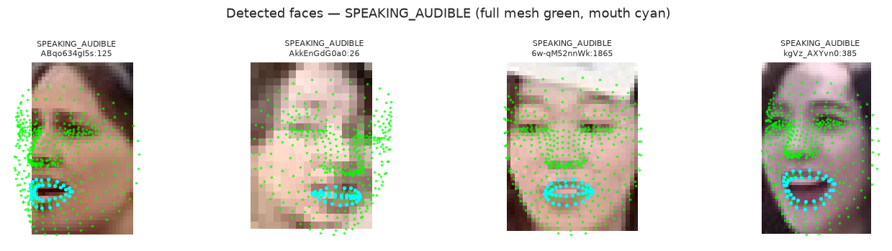
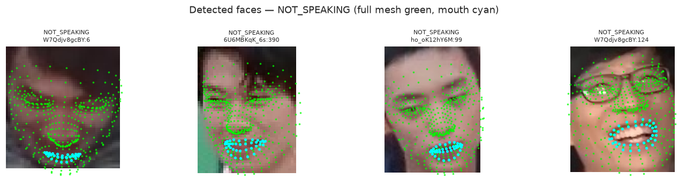
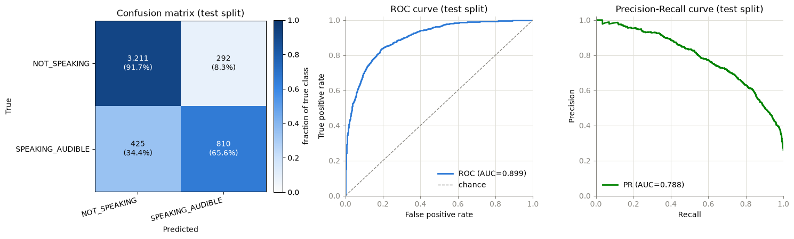

# Active Speaker Detection with Recurrent and Vision Models

This project studies **active speaker detection from visual information**: given a face track, predict whether the visible person is speaking. The model inputs contain no audio. The repository includes three model families, a multi-source data pipeline, training and held-out evaluation scripts, and exploratory notebooks.

The recommended starting point is the landmark BiLSTM. It has the strongest documented result in this repository while using a compact input representation. The image model and vision-language model explore richer visual representations at substantially higher storage and compute cost.

## The three approaches

| Approach | Input and model | Resource profile | Current evidence |
|---|---|---|---|
| **Landmark BiLSTM** | MediaPipe mouth landmarks and mouth-aspect features; BiLSTM predicts a label per frame or per two-second window. | Lowest data and compute cost of the three. Recommended baseline. | The six-source windowed run records **92.90% accuracy and 93.22% F1** on 22,030 held-out windows. |
| **Image CNN+LSTM** | Face-crop images encoded by MobileNetV3-Small and a partially fine-tuned AdaFace backbone, then classified over a sequence by an LSTM. | High image-I/O and GPU cost. The six-source resized-frame cache was measured at about **81 GB**. | Implemented as a training/evaluation pipeline; this repository does not include a comparable published test score. |
| **Vision-language model (VLM)** | Qwen3.5-4B receives 50 sampled face frames and predicts a Yes/No speaking answer; the configured training mode uses LoRA. | Highest model-memory and training cost; downloads multi-gigabyte model weights and processes many image tokens per example. | Experimental scaffold only: it has **not yet been trained or evaluated** on this dataset. It may have the highest accuracy ceiling, but a win has not been demonstrated. |

The VLM is the most expressive approach and is a reasonable research hypothesis for the best eventual accuracy. It is not yet a proven winner. For a practical balance of demonstrated performance, training time, and GPU needs, start with the windowed landmark BiLSTM.

### What the input looks like

The landmark pipeline detects a face mesh and selects the mouth points used by the sequence model. Green marks show the full face mesh; cyan marks show the mouth landmarks.

The notebook gallery contains both successful detections and failure cases. The model’s training pipeline masks undetected frames and filters tracks using a configurable detection threshold.

### Example held-out evaluation

This confusion matrix and pair of curves are from the notebook’s earlier **UniTalk-ASD + AVA windowed experiment** (4,738 test windows). They illustrate the evaluation outputs; they are not the six-source score shown above.

## Pipeline overview

The dataset scripts download and prepare each source separately. They write a common per-frame CSV schema so model variants can share track IDs, timestamps, and labels.

    Download source videos, frames, and annotations
                         |
                         v
    Extract face landmarks and build combined_landmarks.csv
                         |
                         v
    Split each source's held-out raw validation pool into val and test
                         |
              +----------+-----------+
              |          |           |
              v          v           v
       Landmark BiLSTM  Image CNN+LSTM  Qwen vision-language model
       frame/window      image windows  prompted Yes/No per window
              |          |           |
              +----------+-----------+
                         v
                 Held-out evaluation

The train/validation/test split is made at the track level. Training chooses checkpoints with validation data; test data is reserved for final evaluation.

## Setup

### Requirements

- Linux or WSL2 Ubuntu
- Python 3.13
- Git
- FFmpeg for video-based dataset scripts
- A CUDA-capable NVIDIA GPU and compatible driver are recommended for training. CPU execution is possible for development but will be much slower. The requirements install a CUDA-enabled PyTorch build and can download several gigabytes of packages.

### Clone and install

    git clone https://github.com/bmaged23/train-rnn-asd.git
    cd train-rnn-asd

    python3.13 -m venv .venv
    source .venv/bin/activate
    python -m pip install --upgrade pip
    python -m pip install -r requirements.txt

On Ubuntu/WSL, install FFmpeg before running video download or processing scripts:

    sudo apt-get update
    sudo apt-get install -y ffmpeg

Copy the example environment file:

    cp .env.example .env

Open .env and optionally set:

- DATA_ROOT to an absolute path with ample free space. Raw videos, extracted frames, processed CSVs, and caches can require hundreds of gigabytes when using all sources. It defaults to the repository's data directory.
- HF_TOKEN to reduce Hugging Face Hub rate limits. Public dataset downloads do not normally require a token.
- HF_HOME to choose where Hugging Face model weights and caches are stored. This matters especially for the VLM.

The repository ignores local data, model weights, checkpoints, logs, caches, and .env files. They are not committed with the source.

## Download and prepare the datasets

Start with UniTalk-ASD to reproduce the lightweight landmark baseline. These commands download the dataset, fetch the MediaPipe model, extract per-frame features, and create the validation/test split:

    python scripts/dataset/download_dataset.py
    python scripts/dataset/download_model.py
    python scripts/features/process_dataset.py
    python scripts/splits/split_val_test.py

The feature extraction script can resume completed tracks. It writes processed data under DATA_ROOT/processed and records completed track IDs so interrupted processing can continue.

### Add the five optional sources

The combined image and VLM pipelines, and the six-source landmark experiment, use UniTalk-ASD plus AVA, WASD, Columbia, AVSpeech, and SpeakingFaces. Run the matching download, feature-processing, and split commands for each source:

| Source | Download / crop | Extract features | Create val/test split |
|---|---|---|---|
| AVA-ActiveSpeaker | <code>python scripts/dataset/download_ava_subset.py</code> | <code>python scripts/features/process_ava_dataset.py</code> | <code>python scripts/splits/split_ava_val_test.py</code> |
| WASD | <code>python scripts/dataset/download_wasd_subset.py</code> | <code>python scripts/features/process_wasd_dataset.py</code> | <code>python scripts/splits/split_wasd_val_test.py</code> |
| Columbia ASD | <code>python scripts/dataset/download_columbia_subset.py</code> | <code>python scripts/features/process_columbia_dataset.py</code> | <code>python scripts/splits/split_columbia_val_test.py</code> |
| AVSpeech | <code>python scripts/dataset/download_avspeech_subset.py</code> | <code>python scripts/features/process_avspeech_dataset.py</code> | <code>python scripts/splits/split_avspeech_val_test.py</code> |
| SpeakingFaces | <code>python scripts/dataset/download_speakingfaces_subset.py</code>, then <code>python scripts/dataset/crop_speakingfaces_faces.py</code> | <code>python scripts/features/process_speakingfaces_dataset.py</code> | <code>python scripts/splits/split_speakingfaces_val_test.py</code> |

The downloader defaults are configured in config.py. AVA and WASD default to their available subsets without an additional cap; AVSpeech targets 67 hours; SpeakingFaces downloads 142 subjects. Review those settings and the source terms before starting a full download. WASD, Columbia, and AVSpeech use YouTube-hosted video through yt-dlp; access can be rate-limited or unavailable in some environments. The scripts also use Google Drive for some annotations and FFmpeg for video work.

**The image and VLM approaches still require the processed CSV files.** They use those files for track, frame, and label metadata, even though they do not use MediaPipe landmarks as model input. Keep the downloaded face crops on disk as well.

For the dataset origins, processing details, and source-specific caveats, see the module documentation in scripts/dataset/ and scripts/features/. Each source retains its own original license and usage terms; this repository's MIT license does not change them.

## Train and evaluate

Run commands from the repository root with the virtual environment activated. Training scripts save checkpoints under checkpoints/ and logs/ under logs/. A new run overwrites its own named outputs while preserving outputs from the other model approaches.

### Approach 1: Landmark BiLSTM

The per-frame model predicts a speaking label at every detected frame. It uses the UniTalk-ASD data prepared above:

    python scripts/modeling/train/frames.py
    python scripts/modeling/evaluate/frames.py --checkpoint best

The windowed model predicts one label for each two-second window (50 frames at 25 FPS). It is the recommended starting point:

    python scripts/modeling/train/windowed.py
    python scripts/modeling/evaluate/windowed.py --checkpoint best

To train the six-source landmark model, first complete all six source pipelines in the preceding section, then run:

    python scripts/features/build_windowed_all_combined_cache.py
    python scripts/modeling/train/windowed_all_combined.py
    python scripts/modeling/evaluate/windowed_all_combined.py --checkpoint best
    python scripts/modeling/evaluate/windowed_all_combined_per_source.py --checkpoint best

The explicit cache-build step is optional; training builds the window cache automatically if it is missing. The cache is reused when the data and relevant settings match.

### Approach 2: Image CNN+LSTM

This approach uses the same six-source processed CSVs and raw face crops. It combines an ImageNet-pretrained MobileNetV3-Small with a partially trainable AdaFace IResNet100 visual encoder, then models the sequence with a BiLSTM.

Download the AdaFace IResNet100 WebFace4M checkpoint from the pretrained-model section of the [official AdaFace repository](https://github.com/mk-minchul/AdaFace). Save it as models/adaface_ir101_webface4m.ckpt. The MediaPipe landmark model is separate and is downloaded with scripts/dataset/download_model.py.

The resized image cache can be built explicitly, though training also builds it automatically:

    python scripts/features/build_image_resized_cache.py
    python scripts/modeling/train/image_windowed_all_combined.py
    python scripts/modeling/evaluate/image_windowed_all_combined_per_source.py --checkpoint best

Budget about 81 GB for the complete six-source resized-frame cache, in addition to the raw data and processed CSVs. The cache avoids resizing original crops on every training epoch.

### Approach 3: Vision-language model

The VLM uses the same prepared six-source data and face crops. On its first run, Hugging Face downloads the configured Qwen3.5-4B model into the HF_HOME cache. The current configuration uses LoRA, samples 10,000 training windows per source, and is set to one epoch. Treat this as an experimental starting configuration; it is not a completed benchmark.

    python scripts/modeling/train/vlm_all_combined.py
    python scripts/modeling/evaluate/vlm_all_combined_per_source.py --checkpoint best

A large GPU is strongly recommended. The model processes 50 face frames for each window, and VLM memory and throughput depend on GPU type, available memory, model placement, and concurrent workloads. The repository's training script uses gradient accumulation and writes diagnostics to its log. No accuracy claim should be made until this pipeline has completed a real training run and held-out evaluation.

## Recorded results

The repository records these different experiments. Their prediction units and dataset mixtures differ, so compare them only with that context:

| Experiment | Test set | Accuracy | F1 | ROC-AUC | PR-AUC |
|---|---:|---:|---:|---:|---:|
| Six-source windowed landmark BiLSTM | 22,030 windows | 92.90% | 93.22% | 98.29% | 98.53% |
| UniTalk-ASD + AVA windowed BiLSTM, notebook run | 4,738 windows | 84.87% | 69.32% | 89.91% | 78.78% |
| UniTalk-ASD per-frame BiLSTM, notebook run | 160,668 detected frames | 84.34% | 60.87% | 88.45% | 72.04% |

The notebook runs above are included as analysis examples and are not an apples-to-apples comparison with the six-source result. There is no recorded image-model or VLM score in this repository yet.

## Repository layout

    .
    ├── config.py                 # shared paths, feature settings, and experiment configuration
    ├── requirements.txt          # Python dependencies
    ├── src/                      # datasets, models, metrics, and training utilities
    ├── scripts/
    │   ├── dataset/              # download source datasets and model assets
    │   ├── features/             # extract landmarks and build model caches
    │   ├── splits/               # create held-out validation/test CSVs
    │   └── modeling/
    │       ├── train/            # one training entry point per experiment
    │       └── evaluate/         # held-out and per-source evaluations
    ├── notebooks/                # exploratory, sanity-check, and model analysis
    └── docs/assets/               # figures used in this README

## Research notebooks

- notebooks/01_explore_dataset.ipynb — inspect raw UniTalk-ASD labels, tracks, and images.
- notebooks/02_landmark_sanity_check.ipynb — review MediaPipe landmark detections and failure cases.
- notebooks/03_explore_processed_dataset.ipynb — inspect feature coverage and annotated examples.
- notebooks/04_training_analysis.ipynb — analyze the per-frame training curve and test evaluation.
- notebooks/06_unitalk_vs_ava_comparison.ipynb — compare dataset statistics and sample detections.
- notebooks/07_combined_model_test_evaluation.ipynb — inspect a combined-model test report and prediction examples.

## Reproducibility and limitations

- The training scripts seed their experiments and use deterministic PyTorch settings where supported. GPU kernels and driver versions can still affect repeatability.
- Test data is reserved for final evaluation; do not use it for checkpoint selection or model tuning.
- Some source downloaders rely on external hosts, quotas, and YouTube availability. Large downloads are optional if you use only the UniTalk-ASD baseline.
- The VLM implementation remains experimental and has not produced a published held-out result in this repository.
- Inference on an arbitrary new video is not currently provided as a supported command-line workflow.

## License

The project source code is licensed under the MIT License. Dataset contents and pretrained weights remain subject to their respective licenses and terms.
