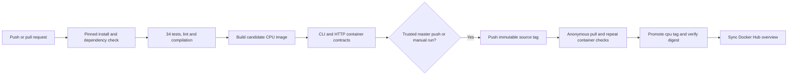

# Docker and CI/CD

## Image scope and requirements

Public repository: https://hub.docker.com/r/bmaged23/train-rnn-asd.
Source: https://github.com/bmaged23/train-rnn-asd.

The `cpu` image packages the API, CLI and pinned CPU dependencies. **Bring your
own windowed BiLSTM checkpoint, matching manifest and prepared features.** No
trained weights, raw datasets, research caches or credentials are included.
The image does not train or download models on startup. It is a Linux x86-64
CPU image; NVIDIA passthrough is unnecessary. Allow several GB of disk headroom
for image extraction/building; actual model/request memory depends on your supplied
architecture. GPU serving is not qualified by this release.

## Pull and run without cloning GitHub

Create a local `models` folder containing your trusted `model.pt` and its matching
`manifest.json`; see the [manifest schema](../inference/README.md). Create a private
`.env` file containing your chosen `ASD_API_TOKEN` if authentication is desired.

```bash
docker pull bmaged23/train-rnn-asd:cpu
docker run --rm --read-only --tmpfs /tmp --env-file .env \
  -p 127.0.0.1:8000:8000 -v "$PWD/models:/models:ro" \
  -e ASD_CHECKPOINT=/models/model.pt -e ASD_MANIFEST=/models/manifest.json \
  bmaged23/train-rnn-asd:cpu
```

Open http://127.0.0.1:8000/docs. Check:

```bash
curl --fail-with-body http://127.0.0.1:8000/health/ready
```

No Git clone, virtual environment or additional pip install is required for this
route. Stop with Ctrl+C. The process runs as UID/GID 10001; mounted model files must
be readable. No checkpoint means liveness may succeed but readiness/prediction
return 503 and Docker eventually marks the container unhealthy. This is deliberate.

Send prepared JSON through [POST /v1/predict](../api/README.md). For CLI use:

```bash
mkdir -p output
# Give UID 10001 suitable write access to output before running this command.
docker run --rm --read-only --tmpfs /tmp \
  -v "$PWD/models:/models:ro" -v "$PWD/input:/input:ro" \
  -v "$PWD/output:/output" bmaged23/train-rnn-asd:cpu \
  -m scripts.inference.predict_windows \
  --checkpoint /models/model.pt --manifest /models/manifest.json \
  --input /input/windows.json --output /output/predictions.json
```

## Local build and verification

From the cloned repository with `requirements/ci.txt` installed:

```bash
docker build -f deployment/docker/Dockerfile -t asd-window-toolkit:local .
python -m scripts.validation.validate_inference_container --image asd-window-toolkit:local
python -m scripts.validation.validate_api_container --image asd-window-toolkit:local
```

These validators temporarily create tiny random-weight checkpoints. They exercise
real inference execution and HTTP transport, compare against native PyTorch,
check failure behavior and remove the temporary containers/files. They establish
packaging correctness, not task accuracy. No synthetic checkpoint is published.

## CI/CD flow

Workflow: [.github/workflows/ci.yml](../../.github/workflows/ci.yml).



Pull requests run checks/builds without receiving publishing credentials. Trusted
`master` pushes and manual runs publish only after passing the same gates.
Documentation-only pushes skip this workflow; manually dispatch it to refresh the
image/Hub overview when appropriate. Runtime and dependency changes trigger it.
Concurrency cancellation prevents overlapping releases for the same branch.

`DOCKERHUB_TOKEN` is an encrypted repository secret with publishing access to the
owner's Docker Hub namespace. It is passed only to the publication step and never
included in the image. Temporary Docker login files are removed after publication.

The candidate is tested before publication; the exact published digest is then
pulled with an empty Docker auth configuration and CLI/HTTP tests run again. Only
then does it become `:cpu`. Source tags use `:sha-<full-source-commit>` and the
workflow summary records the immutable image reference. A tag alone is not an
immutable identifier; use the recorded `@sha256:...` for exact reproduction.

CD delivers a verified toolkit image; it does not replace an existing running
container or deploy a public web server. No model accuracy gate is claimed because
the original checkpoints/labeled data are absent and the owner excluded training.
Failed tests block publication/promotion. A failed post-publication metadata update
can leave an already verified image available while the workflow is red.

## Results and limits

Current local verification: **34 offline tests passed**, plus container CLI parity
and actual HTTP prediction/auth/input/readiness/OpenAPI checks. Historical model
accuracy in the main README is separate and has not been reproduced here.
See the [release record](RELEASE.md) for verified source/run/digest evidence.
